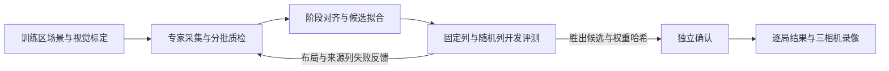

# A3 最高档自主优化

## 2026 年 11 月 19 日确认结果

首个 5.00 分里程碑已达成。按固定列和随机列中较低的正确列均分计，最新独立确认成绩为 **6.85/10**，距 7.50 分仍有 0.65 分。评测沿用期中报告的 `2×5` 和 500 步预算，并在最高随机化档运行。随机列验证使用任务文本指定来源列，每列 5 局。[期中报告](../../期中汇报最终版/midterm_report_merged.pdf) · [期中 PPT](../../A3机器人项目中期汇报_南科大模板_最终版.pptx)

| 独立确认 | 确认组 | 局数 | 上游及正确列均分 | 正确列均分 95% bootstrap 区间 | 完整成功 |
| --- | --- | ---: | ---: | ---: | ---: |
| 首轮 | 固定第 1 列 | 20 | 7.40 | 6.40–8.50 | 3/20 |
| 首轮 | 随机指定列 | 20 | 6.65 | 5.25–8.00 | 5/20 |
| 细粒度续轮 | 固定第 1 列 | 20 | 9.00 | 8.00–9.75 | 9/20 |
| 细粒度续轮 | 随机指定列 | 20 | 6.85 | 6.00–7.75 | 8/20 |

续轮确认使用固定列 `46400–46419` 和随机列 `46500–46519`。这 40 局的终局入盒饼干均来自指定列。25 局得数量满分，17 局触发完整成功。随机组第 1 至第 4 列均分依次为 7.00、7.00、3.40 和 10.00。两轮确认采用不同种子，轨迹结构的配对比较见下方同种子开发结果。[续轮逐局结果](../artifacts/advanced-phase-20261119/confirmation/results.json) · [续轮确认锁](../artifacts/advanced-phase-20261119/confirmation-lock.json)

随机组第 3 列的 5 局均在第 428–430 步才首次观察到至少 5 块入盒，终局合计 17 块。以本组场景的其余列分数为基准，随机组要严格超过 7.50 分，第 3 列需要累计入盒至少 31 块。下一项研究方案是在训练区由 Agent 基于夹爪开度与腕部传感器学习抓取判定，再以首次抓取成功率、重试步数和终局入盒数检验效果。

续轮 40 局均已用锁定权重重新运行 MuJoCo 并录制三路相机。输出动作哈希、分数、来源列、终止步数和成功状态逐局吻合。上游命令行对种子 `46514` 独立复跑，随机第 2 列用 422 步拿到 10 分并完整成功。[40 局完整录像](../artifacts/advanced-phase-20261119/videos/index.html) · [复跑审计](../artifacts/advanced-phase-20261119/videos/replay-audit.json) · [46514 上游记录](../artifacts/advanced-phase-20261119/upstream-cli-46514.json)

### 首轮与恢复记录

首轮随机指定列的第 1 至第 4 列均分依次为 6.20、6.40、5.00 和 9.00。40 局的入盒饼干均来自题目指定列。17 局达到数量满分，其中 8 局触发上游完整成功判定，其余 9 局达到 500 步上限。随机组有 3 局得 0 分。历史冻结策略同档复评两组均为 0.90 分，确认种子与本报告不同。[首轮逐局结果](../artifacts/advanced-agent-resumed-20261119/confirmation/results.json) · [历史复评](A3_ROBUSTNESS_AUDIT.md)

Agent 在 640 个训练区场景上标定视觉，按覆盖安排 40 次专家尝试，保留 37 个第一批和 36 个第二批。开发集固定列和随机列的胜出候选分别为 8.33 和 8.38 分。两组确认成绩比对应开发均分低 0.93 和 1.73 分，说明小开发集上的晋级分数会高估泛化。首轮确认使用固定列 `42400–42419` 和随机列 `42500–42519`。正式评测锁记录候选和权重哈希。[训练账本](../artifacts/advanced-agent-resumed-20261119/round-01/dataset.json) · [候选对比](../artifacts/advanced-agent-resumed-20261119/round-01/decision.json) · [确认锁](../artifacts/advanced-agent-resumed-20261119/confirmation-lock.json)

首轮采集中断后恢复了 37 个已落盘的专家文件。Agent 核对了文件的种子、列号、盒位标签和重新对齐的轨迹，并为恢复文件记录了哈希。中断时只写入了这些文件，原始逐局采集回执缺失。40 个确认回合都在权重锁定后完整运行。[恢复记录](../artifacts/advanced-agent-resumed-20261119/round-01/dataset.json)

40 局独立重跑的输出动作哈希、来源列计数、分数、终止步数和完整成功标志逐局吻合。21,207 帧通过解码检验，包含 19,607 帧重置与控制步画面，以及每局 40 帧的终局停留。上游命令行也加载了同一权重。种子 `42502` 用 436 步得 10 分并完整成功，种子 `42400` 得 10 分并在第 500 步因超时终止。[完整录像](../artifacts/advanced-agent-resumed-20261119/videos/index.html) · [录像审计](../artifacts/advanced-agent-resumed-20261119/videos/replay-audit.json) · [42502 上游记录](../artifacts/advanced-agent-resumed-20261119/upstream-cli-42502.json) · [42400 上游记录](../artifacts/advanced-agent-resumed-20261119/upstream-cli-42400.json)

## 评测目标

上游 2×5 `advanced` 档以 500 个控制步为限。首个里程碑是均分至少 5.00，最终目标是均分严格高于 7.50。Agent 同时验证固定第 1 列和随机指定列，每组各用 20 个确认种子。两组均达到阈值时，才记录相应的整体里程碑。随机列组覆盖四列，每列 5 局。

两组都启用 `advanced` 的场景扰动。源盒和目标盒平移幅度为每轴 20 mm，目标盒偏航幅度为 0.080 rad。固定相机与腕相机各有位置和角度扰动，视场角扰动幅度为 2°，灯光强度扰动幅度为 20%。饼干同时有位置、朝向和颜色扰动。[上游随机化配置](../../a3_dual_arm_sim/configs/randomization.yaml)

上游得分计目标盒内的饼干数。随机列和固定列都额外核对饼干的初始来源，候选选择和里程碑按正确来源列的终局入盒数量计算。完整成功还需满足上游槽位、安全和稳定规则。[原高级档审计](A3_ROBUSTNESS_AUDIT.md)

## Agent 自主闭环



1. 锁定上游版本、配置摘要、阶段预算和三组互斥种子。确认候选和种子在评测前写入锁文件。
2. 使用训练区场景的相机图像、盒体轮廓和桌面边缘拟合相机扰动下的定位器。世界坐标标签来自训练环境。定位器的特征组合和正则系数由训练区内的留出样本自动选择。
3. 按四列覆盖、布局差异和颜色覆盖安排专家采样。随后将开发集的失败按来源列和初始布局映射到训练池中的新场景。记录全部专家尝试与淘汰原因。专家采集的上限是 750 步，确认上限是 500 步。
4. 用仿真器实际应用的 16 维关节动作，按抓取、抬升、搬运、插入和释放等专家阶段对齐轨迹。一次完整示范可提供两批样本。失败回合里已稳定释放、来源正确且源盒余量匹配的第一批可保留。
5. 在相同的 500 步开发评测上比较候选。候选分别用全部盒位特征、分阶段相关盒位特征拟合动作，并由 Agent 根据历轮候选改变邻域和正则。运行中的策略用首帧 RGB 和指定列文本生成动作序列。
6. 以两组较低的均分优先级最高，平均表现与完整成功用于平分时的比较。锁定开发候选及权重哈希后运行确认。输出逐局来源、分数、步数、失败原因、动作哈希和置信区间。

训练、采样、调参和确认通过同一个项目 Agent 进程执行。相机图像和任务文本是策略的输入。分组、采样优先级和真值诊断留在 Agent 侧。

## 动作阶段细化

首轮确认有 16 局终局为 5 分，其中 9 局超过第 300 步才首次入盒 5 块。另外 9 局入盒 10 块仍达到步数上限。关注阶段末端的抓取动作和放置稳定性，有助于定位两类失分。[逐局评测](../artifacts/advanced-agent-resumed-20261119/confirmation/results.json)

连续轨迹模型把预闭、下降和夹紧分到各自阶段，保留每个阶段的持续时间及最后一个动作。从训练轨迹按局留一，自动为两批各选一组分阶段正则系数。留一损失同时衡量全段动作和阶段末端动作。原分阶段模型与细粒度模型使用同一份专家数据和同一组开发种子，使开发对比能反映轨迹模型的差异。[动作模型](../src/a3opt/backends/advanced_phase.py)

后续 Agent 从首轮开发记录读取失败场景，用 `44000` 起的新种子块采集专家数据。固定列开发组含 8 局，随机列开发组含 12 局，每列 3 局。采样与拟合全程由 Agent 执行，确认各 20 局，并沿用 500 步任务口径。细粒度模型仍用首帧的一次视觉估计和开环执行。[续轮 Agent](../src/a3opt/advanced_followup.py)

| 累计专家尝试 | 轨迹架构 | 固定列开发均分 | 随机列开发均分 | 开发完整成功 |
| ---: | --- | ---: | ---: | ---: |
| 72 | 原分阶段 | 8.125 | 6.667 | 9/20 |
| 72 | 细粒度阶段 | 7.500 | 6.333 | 5/20 |
| 104 | 原分阶段 | 8.125 | 6.833 | 11/20 |
| 104 | 细粒度阶段 | 8.125 | 7.000 | 8/20 |

累计 104 次采集后，四列分别保留 `30/29`、`36/35`、`19/16`、`10/9` 个第一批和第二批样本。Agent 依据预先设定的较低组均分选中了第二轮细粒度模型。它在开发集上提高了随机列的数量分，原分阶段候选的完整成功更多。[首轮开发决策](../artifacts/advanced-phase-20261119/round-01/decision.json) · [次轮开发决策](../artifacts/advanced-phase-20261119/round-02/decision.json) · [续轮确认锁](../artifacts/advanced-phase-20261119/confirmation-lock.json)

## 启动与证据

在优化器仓库根目录运行。整轮由 Agent 决定采样种子及列分配、拟合参数、候选晋级和确认权重。使用相同参数和输出目录可恢复已完成的回合。

```powershell
$sim = (Resolve-Path '..\a3_dual_arm_sim').Path
$env:PYTHONPATH = "$PWD\src;$sim\src"
$env:OPENBLAS_NUM_THREADS = '1'
$env:OMP_NUM_THREADS = '1'
& "$sim\.venv\Scripts\python.exe" -u -m a3opt.cli advanced `
    --out artifacts/advanced-agent-reproduction --workers 16
```

用新种子块启动续轮。

```powershell
& "$sim\.venv\Scripts\python.exe" -u -m a3opt.cli advanced-followup `
    --reference artifacts/advanced-agent-resumed-20261119 `
    --out artifacts/advanced-phase-20261119 --workers 20
```

确认完成后可以对冻结的策略重新运行物理仿真并生成 H.264 录像。回放审计校验训练谱系、确认锁和逐局分数，并将真实回放的动作哈希、终局饼干来源、终止步数与确认记录比较。每段录像按 20 Hz 保留重置、一帧对应一个执行步的三路画面，以及 2 秒终局停留。

```powershell
$ffmpeg = (Get-Command ffmpeg -CommandType Application).Source
& "$sim\.venv\Scripts\python.exe" -u -m a3opt.advanced_audit `
    artifacts/advanced-phase-20261119 --ffmpeg $ffmpeg --workers 20
```

| 产物 | 用途 |
| --- | --- |
| `protocol.json` | 固定评测任务、仿真版本、代码哈希和预算 |
| `calibration.json` | 训练区内各定位候选的误差和自动选择 |
| `expert/*.json` | 专家尝试、通过的动作批次及数据哈希 |
| `round-*/plan.json` 和 `decision.json` | 采样依据、候选对比和晋级记录 |
| `confirmation-lock.json` | 选中的权重哈希和预设确认种子 |
| `confirmation/results.json` 和 `result.json` | 逐局结果、置信区间和里程碑 |
| `videos/index.html` 和 `videos/replay-audit.json` | 完整录像索引、逐局动作一致性、解码帧数与视频哈希 |

## 研究方案

| 工作 | 用于项目的实验模块 | 可核验指标 |
| --- | --- | --- |
| Tobin 等，2017，Domain Randomization | 训练区覆盖盒位、视角、光照和饼色，同时记录定位误差。 | 每轴位置误差、目标盒偏航误差、各颜色分数 |
| Zhao 等，2023，ACT | 在视觉定位基线之上比较多帧观测、动作分块和短执行窗口。当前阶段对齐只借鉴动作时序分解。 | 第二批成功率、完整成功率、推理耗时 |
| Ross 等，2011，DAgger | 由训练区策略触发专家接管，将失配后可恢复的状态加入数据集。 | 接管后的恢复率、相同专家尝试预算下的配对增益 |

[Domain Randomization 论文](https://arxiv.org/abs/1703.06907) · [ACT 论文](https://arxiv.org/abs/2304.13705) · [DAgger 论文](https://proceedings.mlr.press/v15/ross11a.html)
