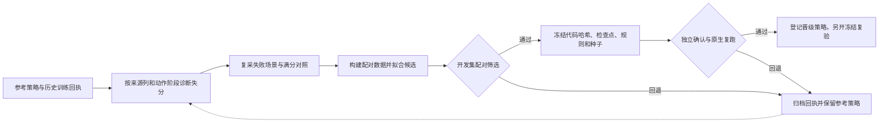
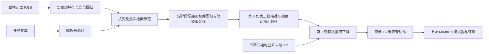

# A3 当前 Agent 与模型架构

2026 年 11 月 20 日版本。发布策略为 `branch-joint` 分阶段示范策略，叠加第 4 列第二批缩时和第 1 列首批垂直下降。在 `2×5 / advanced` 四列平衡随机评测的首批 100 对场景中，均分从 **8.79 提升至 9.14/10**，候选均分 95% 区间为 **[8.77, 9.49]**。后续放置实验的 128 个四列平衡场景中，同一策略的均分为 **8.88/10**。合计 228 个唯一种子，每列 57 局，发布策略记录 **2051 块**，课程终局与第 500 步释放均分均为 **8.9956/10**，按列分层的 95% 区间为 **[8.69, 9.28]**，严格完整成功为 **143/228**。第 1 至第 4 列均分分别为 **8.77、8.32、9.74、9.16**。 [实验树](A3_EXPERIMENT_TREE.md) · [首批证据](../evidence/advanced-20261120/README.md) · [后续 128 对回执](../evidence/routed-20261120/README.md)

2026 年 11 月 21 日，第二列第二批的接触恢复通过独立确认。策略在该批下降后段读取公开末端高度，当跟踪误差达到训练阈值时抬升并向外移，再定点开爪。64 对四列平衡评测的课程终局和第 500 步释放均分均为 **8.921875 → 9.171875/10**，配对增益的 95% 区间为 **[+0.046875, +0.484375]**，严格完整成功均为 **35/64**。候选绝对均分区间为 **[8.734375, 9.5625]**。 [接触恢复的逐局回执及原生复跑](../evidence/release-recovery-20261121/README.md)

随后 128 对四列平衡场景的冻结复验得到 **9.1796875 → 9.21875/10**，配对增益 95% 区间为 **[0, +0.1015625]**，候选绝对均分区间为 **[8.8671875, 9.5390625]**。严格完整成功均为 **83/128**。复验保留参考，9 分仍处于候选绝对均分区间内。 [复验回执](../evidence/release-recovery-20261121/replication-result.json)

第 1 列首批提前抬高内移在 24 对新开发场景中的均分为 **9.33 → 9.33/10**，三局各少计 4 块。逐阶段回执显示，四局退化均伴随第二批下降时的倾斜。Agent 先复采 35 个场景的公开观测前缀，按已结束的配对结果训练启用条件，留组出现一局退化，故回退该分支。 [整局开发](../evidence/early-clearance-20261121/README.md) · [门控训练](../evidence/clearance-refine-20261121/README.md)

Agent 在第 1 列的 9 局训练场景中验证了四种第二批避让轨迹，均降低终局入盒数，随后回退。另一分支从历史下降损失中选出第 2 列首批，采集 10 次专家示范，学习盒坐标系中的开爪位置。独立开发的 16 对第 2 列场景从 **8.0625 升至 8.75/10**，严格完整成功从 **4/16 升至 11/16**。 [两批避让](../evidence/interbatch-20261121/README.md) · [专家开爪位置](../evidence/expert-landing-20261121/README.md)

首批专家开爪策略在 64 对高难场景中把指定来源终局均分从 **9.171875 提升至 9.53125/10**，95% 区间为 **[9.0625, 9.921875]**，严格完整成功从 **35/64 增至 48/64**。两组均在同一第 3 列场景多搬一块相邻列饼干。Agent 按原有错列门槛回退。 [逐局与原生复跑证据](../evidence/expert-landing-20261121/README.md)

## Agent 架构

| 层 | 实现 | 职责 |
| --- | --- | --- |
| 通用实验调度 | [`loop.py`](../src/a3opt/loop.py)、[`planner.py`](../src/a3opt/planner.py)、[`tree.py`](../src/a3opt/tree.py) | 从合法候选空间提出方案，在预算内用 UCT 选择扩展位置，调用训练和评测后端。 |
| 任务专项采样 | [`advanced_agent.py`](../src/a3opt/advanced_agent.py)、[`branch_agent.py`](../src/a3opt/branch_agent.py)、[`placement_descent_refine.py`](../src/a3opt/placement_descent_refine.py) | 读取训练回执、按失分阶段复采失败与满分场景、校验配对数据、拟合示范或选择限幅控制参数。 |
| 候选筛选 | [`placement_search.py`](../src/a3opt/placement_search.py)、[`acceptance.py`](../src/a3opt/acceptance.py) | 通用循环比较配对增益、非劣比例和成本。放置分支要求两种计分均有正向配对增益、完整成功数至少持平，并核对错列、安全停止和单局少计至少 4 块的事件。 |
| 实验证据 | [`memory.py`](../src/a3opt/memory.py)、[`placement_benchmark.py`](../src/a3opt/placement_benchmark.py)、[`audit_placement_confirmation.py`](../scripts/audit_placement_confirmation.py) | 通用循环用 JSONL 保存状态、指标、成本和候选 ID。专项流程分别保存协议、采集计划、逐局回执、冻结记录和原生复跑核对。 |

人负责设定候选空间、预算和验收规则。项目 Agent 完成场景选择、模拟器采集、数据整理、拟合与选模。最佳下降分支在第 1 列复采三局失分与三局满分对照，比较首批、第二批及两批干预，再打开独立开发集。确认种子只用于冻结后的验证。 [自动采集实现](../src/a3opt/placement_descent_refine.py) · [采集计划](../evidence/advanced-20261120/acquisition-plan.json)

## 最佳模型架构

1. **感知与检索。** 从首帧正面 RGB 提取盒轮廓和形态特征，估计源盒和目标盒的位置及目标盒偏航。任务文本给出来源列，模型据此按列和批次收集对应示范。 [视觉定位](../src/a3opt/backends/advanced_trajectory.py) · [按列和批次生成动作](../src/a3opt/backends/adaptive_phase.py)
2. **分阶段示范策略。** 两批各五块。每阶段用邻近布局的已对齐动作做局部加权岭回归，再按估计时长重采样并平滑阶段边界。`branch-joint` 清除第 3 列首批第 7 关节轨迹的少数分支，第 3 列放置阶段使用源盒与目标盒的联合特征。这一检查点由轨迹库、视觉回归参数和控制配方组成。 [分支拟合](../src/a3opt/branch_agent.py) · [分阶段回归](../src/a3opt/backends/advanced_phase.py)
3. **时序与放置。** 第 4 列第二批只缩短接近与搬运时长。第 1 列首批在进入下降阶段时读取公开末端 XY，以该点为开爪前的横向锚点。名义运动学将每轴最多 8 mm 的校正映射为关节动作，退臂时平滑撤去校正。上游模拟器执行每步 16 维双臂动作。 [时间缩放](../src/a3opt/release_timing_agent.py) · [下降控制](../src/a3opt/placement_descent_agent.py)

零修正分支用命令、实际执行与计分回执核对。模拟器内部位姿、饼干身份与接触用于采集标注和评测。策略运行时读取任务文本与公开观察，并使用冻结配方。 [冻结控制器](../evidence/advanced-20261120/controller.json) · [联合评测实现](../src/a3opt/placement_benchmark.py)

## 评测与可确认的结论

课程介绍第 9–11 页的评测接口给出 `2×5 / 2×10` 与 `basic / medium / advanced` 的六组网格，主口径为 500 控制步内的终局入盒数量。上游配置分别定义盒体、相机、灯光、饼干颜色等重置扰动。最高档的盒体 XY 各轴偏移达 ±20 mm，目标盒偏航达 ±0.08 rad。饼干初始平面扰动仍为 ±0.3 mm，因此初始排列通常整齐。 [上游随机化配置说明](https://github.com/Eter0109/a3_dual_arm_sim/blob/5fa24970648f53a24c0b5038d19bf6a14e1be5b9/docs/randomization.md)

| `2×5 / advanced` 四列平衡 | 对数 | 课程终局均分 | 第 500 步释放均分 | 严格完整成功 |
| --- | ---: | ---: | ---: | ---: |
| 首次确认 `132100–132139` | 40 | 8.675 → 9.05 | 8.675 → 9.05 | 20 → 24 |
| 冻结复验 `138000–138059` | 60 | 8.87 → 9.20 | 8.87 → 9.20 | 39 → 41 |
| 合并 | 100 | **8.79 → 9.14** | **8.79 → 9.14** | **59 → 65** |

第 500 步的诊断口径要求已释放入槽并连续 20 步满足完整成功条件。合并样本的分层配对增益 95% 区间为 **[+0.15, +0.60]**，均分区间为 **[8.77, 9.49]**，因此证据支持配对提升，9 分是点估计达到的门槛。两批各抽四列、分别核验两套规则，共 16 次原生复跑匹配。第 1 列从 7.80 升至 9.20，第 2 列保持 8.32。 [汇总](../evidence/advanced-20261120/replication-result.json) · [逐局得分](../evidence/advanced-20261120/paired-endpoints.csv)

`2×10 / advanced` 使用独立的原生四批策略与 500 步评测。最近示范检索在固定第 1 列的 20 对独立场景中从 1.80 升至 3.15/20，配对区间跨零，两侧完整成功均为 0/20，Agent 保留加权平均参考。历史六组网格及课程对照见专项报告。 [原生 2×10 结果](../evidence/advanced-20261120/two-by-ten-result.json) · [课程对齐](A3_COURSE_ALIGNMENT.md)
