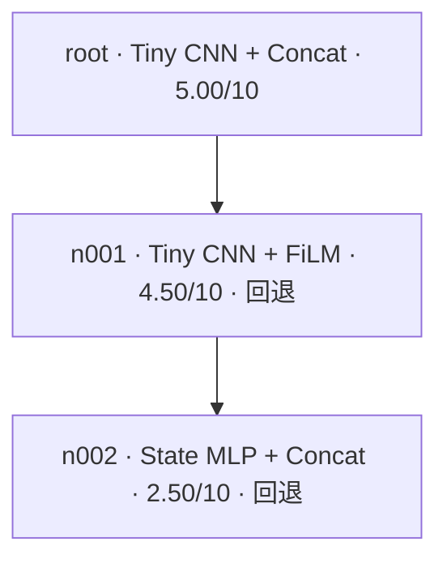
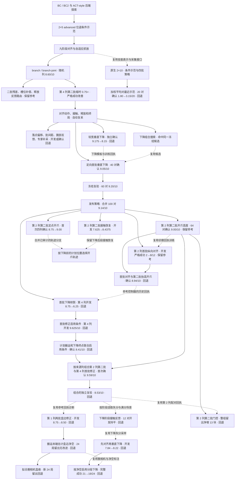

# A3 实验树与策略演进

项目包含通用候选搜索树，以及 `2×5` 和 `2×10` 专项 Agent 留下的实验谱系。统计快照为 2026 年 11 月 20 日。 [Agent 和模型架构](A3_CURRENT_ARCHITECTURE.md) · [运行目录索引](../evidence/advanced-20261120/run-index.csv)

## 代码中的候选搜索树

根节点执行参考策略。`ExperimentTree` 根据节点访问次数、历史平均回报和探索常数计算 UCT，优先选择未访问且可扩展的节点。`StagedPlanner` 遍历已定义的候选顺序，按候选 ID 去重。训练和评测结束后，归一化得分沿父链回传，配对闸门决定候选能否参与最终选模。节点保存父节点、子节点、访问次数、累计值、阶段和执行状态。 [树](../src/a3opt/tree.py) · [候选顺序](../src/a3opt/planner.py) · [执行与验收](../src/a3opt/loop.py)

图取自 `final-tree-60ep` 的父子记录。父子边表示搜索扩展顺序，节点的最终配对参照始终是根节点。该 `basic` 轮次训练 3 个候选（含参考），合计 24,000 训练步，使用种子 `2000`、`2001`。 [历史树报告](A3_Agent_优化框架_架构与实验树报告.md)

## 实际实验谱系

实线表示策略或实验流程的继承，虚线表示复用训练证据、候选或接口。图中历史分数对应各自的种子、时限和评分设置。通用 UCT 的 `tree.json` 覆盖通用后端轮次，专项 Agent 的分支、回退和复验由其协议及回执记录。 [分阶段方案](A3_ADAPTIVE_AGENT.md) · [放置搜索](A3_PLACEMENT_SEARCH.md) · [课程与 2×10](A3_COURSE_ALIGNMENT.md)

| 分支 | 配对证据与决策 |
| --- | --- |
| 第 4 列第二批缩时 | 固定第 4 列的 20 对独立确认中，严格完整成功由 0/20 升至 16/20。冻结时长为原时长的 `0.75×`。 |
| 较宽垂直下降 | 开发期出现改善，40 对独立确认从 9.175 降至 8.15，5 对少计至少 4 块。保留参考。 |
| 定向首批垂直下降 | 第 1 列采集三局失分和三局满分对照。40 对首次确认晋级，60 对冻结复验通过，合并均分 9.14。 |
| 下降候选组合 | 组合搜索返回 `equivalent_candidate_in_confirmation`，复用定向候选的确认记录。 |
| 第 2 列第二批开爪高度 | 64 对四列平衡确认从 8.78 升至 9.00，配对增益区间 [+0.03, +0.44]，严格完整成功均为 38/64。预设门槛为均分严格超过 9，保留发布策略。 |
| 第 2 列首批纵向对齐 | 12 对闭环开发中严格完整成功从 2/12 升至 8/12，计数均分从 8.50 降至 8.33。组合试验使用原拟合参数，独立保留确认集。 |
| 首批对齐与第二批抬高开爪 | 64 对四列平衡确认的课程均分从 8.66 升至 8.94，严格完整成功从 40/64 升至 48/64。得分增益区间跨零，一局课程口径少计 4 块，Agent 判定回退。 |
| 第 4 列首批开爪高度 | 首批训练分支多计 18 块。8 对完整回合开发从 8.75 降至 6.25，6 局在第二批少计 5 块。 |
| 第 4 列首批修正启用条件 | 16 对完整回合开发从 9.00 升至 9.625，严格完整成功从 8/16 降至 7/16，一局少计 5 块。Agent 保留参考。 |
| 第 4 列首批联合阈值 | 16 对开发从 9.375 升到 9.6875。64 对独立确认从 8.328125 升到 8.40625，严格完整成功均为 37/64，配对增益区间下限为 0。Agent 保留参考。 |
| 第 2、4 列修正组合 | 64 对独立确认从 9.375 升到 9.59375，严格完整成功均为 44/64，配对增益区间下限为 0。首次确认保留参考，另用冻结参数复验。 |
| 第 2、4 列组合复验 | 新 64 对的均分 8.390625→8.53125，严格完整成功 34→33/64。两组共 128 对，候选均分 9.0625，95% 区间 [8.640625, 9.4453125]。Agent 回退组合。 [公开回执](../evidence/routed-20261120/README.md) |
| 第 1 列盒边修正 | 定向训练 6.25→9.75，16 对新开发 8.75→8.50。误触发使一局少计 4 块，Agent 回退候选。 |
| 搬运末端净空 | 30 个拟合场景选出末端位姿模型。24 个留出场景中，两模型各漏判 6/15、误触发 3/30，Agent 在整局开发前回退。 [公开回执](../evidence/feedback-20261120/README.md) |
| 下降中的接触反馈 | Agent 从 14 个训练场景选择第 1 列首批修正。12 对新场景的得分均为 9.58/10，严格完整成功均为 10/12，Agent 回退。 [公开回执](../evidence/feedback-20261120/README.md) |
| 第 2 列第二批开爪门控 | 4 组共 68 对历史样本。逐组留出的门控净增 13 块，低于常开修正的 46 块，Agent 回退。 [公开回执](../evidence/feedback-20261120/README.md) |
| 先对齐再垂直下降 | 32 对新开发均分 7.84→8.22，严格完整成功 7/32→9/32。首批改动影响第二批，一局少计 5 块，Agent 回退。 [公开回执](../evidence/feedback-20261120/README.md) |
| 首批分段下降净空门控 | 24 对第 1 列新开发均分 9.58→9.67，严格完整成功 21/24→19/24。Agent 回退。 [公开回执](../evidence/feedback-20261120/README.md) |
| 第 2 列第二批定点开爪 | 64 对四列平衡确认均分 8.75→9.00，第 2 列均分 7.00→8.00，严格完整成功均为 42/64。Agent 回退。 [公开回执](../evidence/release-hold-20261121/README.md) |
| 第 2 列第二批接触恢复 | 16 对第 2 列新开发均分 7.625→8.4375，严格完整成功均为 1/16。通过开发筛选。 [公开回执](../evidence/release-recovery-20261121/README.md) |
| 定点开爪与接触恢复的选择 | Agent 核对两个干预分支的基准物理末态，复用 10 局已有配对记录，按历史训练组补采 13 局。 [实现](../src/a3opt/placement_release_router.py) |
| `2×10` 最近示范检索 | 20 对独立确认均分 1.80 → 3.15/20，配对差区间 [−0.35, +3.05]。保留加权平均参考。 |

[较宽方案结果](../evidence/advanced-20261120/broad-descent-result.json) · [定向候选结果](../evidence/advanced-20261120/confirmation-result.json) · [冻结复验结果](../evidence/advanced-20261120/replication-result.json) · [2×10 结果](../evidence/advanced-20261120/two-by-ten-result.json)

## 实验数量

| 计数单位 | 数量 | 统计依据 |
| --- | ---: | --- |
| 通用树运行 | 3 | `bc2-loop-500`、`final-tree-60ep`、`real-loop-500` 均有 `tree.json`。 |
| 通用树已执行节点 | 9 | 每轮 3 个节点，含 3 个参考节点与 6 个候选节点。 |
| 发布快照的专项运行目录 | 66 | `artifacts/` 下名称后缀为 `-20261119` 或 `-20261120` 的运行目录。 |
| 发布快照中带根目录结果的专项运行 | 54 | 51 个 `result.json` 与 3 个仅有 `results.json` 的目录。其余 12 个目录保留中间记录或不同名称的汇总。 |
| 发布策略的独立确认 | 100 对 | 40 对首次确认加 60 对冻结复验。每对含参考与候选各一局，对应 200 局物理执行，另有 16 次原生复跑核对。 |

目录数量包括采集、预检、恢复、候选筛选、确认和复验。同一目录可对应多个候选和种子，组合搜索也可复用候选。 [逐目录状态](../evidence/advanced-20261120/run-index.csv)
