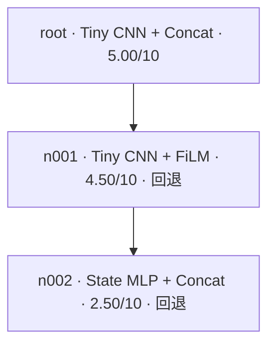
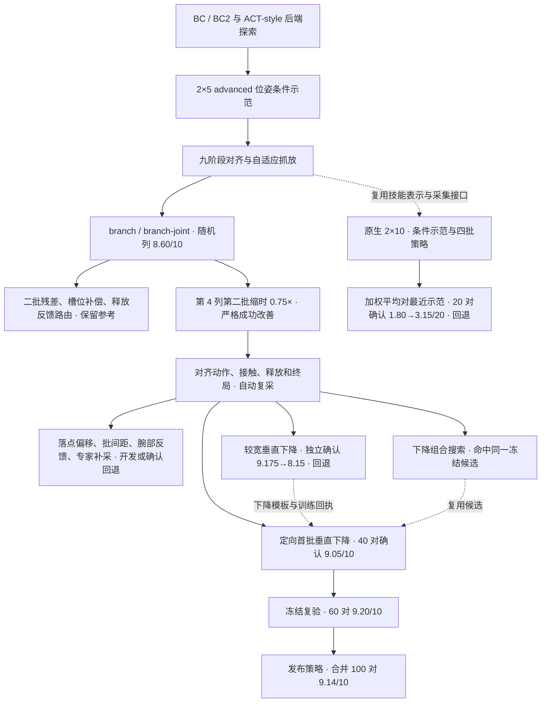

# A3 实验树与策略演进

项目包含通用候选搜索树，以及 `2×5` 和 `2×10` 专项 Agent 留下的实验谱系。统计快照为 2026 年 11 月 20 日。 [Agent 和模型架构](A3_CURRENT_ARCHITECTURE.md) · [运行目录索引](../evidence/advanced-20261120/run-index.csv)

## 代码中的候选搜索树

根节点执行参考策略。`ExperimentTree` 根据节点访问次数、历史平均回报和探索常数计算 UCT，优先选择未访问且可扩展的节点。`StagedPlanner` 遍历已定义的候选顺序，按候选 ID 去重。训练和评测结束后，归一化得分沿父链回传，配对闸门决定候选能否参与最终选模。节点保存父节点、子节点、访问次数、累计值、阶段和执行状态。 [树](../src/a3opt/tree.py) · [候选顺序](../src/a3opt/planner.py) · [执行与验收](../src/a3opt/loop.py)

图取自 `final-tree-60ep` 的父子记录。父子边表示搜索扩展顺序，节点的最终配对参照始终是根节点。该 `basic` 轮次训练 3 个候选（含参考），合计 24,000 训练步，使用种子 `2000`、`2001`。 [历史树报告](A3_Agent_优化框架_架构与实验树报告.md)

## 实际实验谱系

实线表示策略或实验流程的继承，虚线表示复用训练证据、候选或接口。图中历史分数对应各自的种子、时限和评分设置。通用 UCT 的 `tree.json` 覆盖通用后端轮次，专项 Agent 的分支、回退和复验由其协议及回执记录。 [分阶段方案](A3_ADAPTIVE_AGENT.md) · [放置搜索](A3_PLACEMENT_SEARCH.md) · [课程与 2×10](A3_COURSE_ALIGNMENT.md)

| 分支 | 配对证据与决策 |
| --- | --- |
| 第 4 列第二批缩时 | 固定第 4 列的 20 对独立确认中，严格完整成功由 0/20 升至 16/20。冻结时长为原时长的 `0.75×`。 |
| 较宽垂直下降 | 开发期出现改善，40 对独立确认从 9.175 降至 8.15，5 对少计至少 4 块。保留参考。 |
| 定向首批垂直下降 | 第 1 列采集三局失分和三局满分对照。40 对首次确认晋级，60 对冻结复验通过，合并均分 9.14。 |
| 下降候选组合 | 组合搜索返回 `equivalent_candidate_in_confirmation`，复用定向候选的确认记录。 |
| `2×10` 最近示范检索 | 20 对独立确认均分 1.80 → 3.15/20，配对差区间 [−0.35, +3.05]。保留加权平均参考。 |

[较宽方案结果](../evidence/advanced-20261120/broad-descent-result.json) · [定向候选结果](../evidence/advanced-20261120/confirmation-result.json) · [冻结复验结果](../evidence/advanced-20261120/replication-result.json) · [2×10 结果](../evidence/advanced-20261120/two-by-ten-result.json)

## 实验数量

| 计数单位 | 数量 | 统计依据 |
| --- | ---: | --- |
| 通用树运行 | 3 | `bc2-loop-500`、`final-tree-60ep`、`real-loop-500` 均有 `tree.json`。 |
| 通用树已执行节点 | 9 | 每轮 3 个节点，含 3 个参考节点与 6 个候选节点。 |
| 专项运行目录 | 66 | `artifacts/` 下名称后缀为 `-20261119` 或 `-20261120` 的运行目录。 |
| 带根目录结果的专项运行 | 54 | 51 个 `result.json` 与 3 个仅有 `results.json` 的目录。其余 12 个目录保留中间记录或不同名称的汇总。 |
| 发布策略的独立确认 | 100 对 | 40 对首次确认加 60 对冻结复验。每对含参考与候选各一局，对应 200 局物理执行，另有 16 次原生复跑核对。 |

目录数量包括采集、预检、恢复、候选筛选、确认和复验。同一目录可对应多个候选和种子，组合搜索也可复用候选。 [逐目录状态](../evidence/advanced-20261120/run-index.csv)
