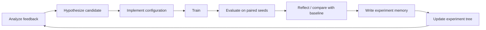

# Architecture

The [refinement report](A3_REFINEMENT_REPORT.md) describes the executable data collection loop,
the layout-conditioned policy, and the held-out confirmation protocol. This document records the
original experiment tree design.

This repository implements the agent-driven optimization layer described in the midterm report
(`project/期中汇报最终版/midterm_report_merged.pdf`, Section 3) as runnable code. The layer sits on
top of an existing robot-policy stack: it never re-implements the simulator, the task success rules,
or the expert controller. It selects experiments, runs them, reads structured feedback, records
evidence, and decides what to try next.

## 1. What the agent decides

The object of optimization is a sequence of experiments, not a single prediction.
A robot policy maps observations to actions at runtime, while the agent selects policy modules and
training configurations, launches training and evaluation, reads the results, and proposes the next
experiment. Three decision layers are kept separate:

| Layer | Decides | Implemented by |
| --- | --- | --- |
| Deployment | one action per control step | the trained robot policy |
| Training | how weights are learned from demonstrations | the configured trainer |
| Experiment search | which candidate to train next and whether to keep it | this repository (`a3opt`) |

## 2. Experiment loop



Each iteration is one candidate experiment: a specification is materialized, trained under a fixed
budget, evaluated on a fixed seed block, and compared with the baseline through a paired-seed gate.
The loop is bounded by an explicit experiment budget and stops when the budget is exhausted or the
candidate space is covered.

## 3. Candidate space

The search space mirrors the modular policy design in the report: feature extraction and policy
learning are separated, and candidates are legal combinations of module choices.

| Dimension | Values | Meaning |
| --- | --- | --- |
| `encoder` | `tiny_cnn`, `state_mlp` | visual feature extractor versus state-only encoder |
| `fusion` | `concat`, `film` | how the encoding is passed to the learner |
| `action_head` | `mlp`, `chunk` | single-step prediction versus action chunk |
| `chunk_size` | `1`, `20`, `50` | actions predicted per forward pass |
| `image_size` | `0`, `64` | observation window (0 means no image input) |
| `lr` | `1e-3`, `3e-3` | optimization rate |

Compatibility rules reject illegal combinations before any training starts:

- `state_mlp` requires `image_size == 0`; `tiny_cnn` requires `image_size > 0`.
- `film` requires an image encoder.
- `action_head == "chunk"` requires `chunk_size > 1`; `mlp` requires `chunk_size == 1`.

Candidates are ordered as a staged screening list, so the first rounds answer one design question at
a time (baseline, encoder variants, head/chunk variants, learning-rate variants) before combining
them. The full Cartesian product is never enumerated blindly.

## 4. Experiment tree and UCT selection

The tree records every experiment as a node carrying its candidate, parent, training metrics,
per-seed evaluation scores, cost, and artifact paths. Selection uses the upper confidence bound for
trees:

```text
UCT(v) = Q_v / N_v + c * sqrt( ln N_parent(v) / N_v )
```

where `Q_v` is the accumulated normalized reward of node `v`, `N_v` is its visit count, and `c`
defaults to 0.7. Unvisited nodes are expanded first; afterwards the node with the largest UCT among
expandable nodes receives the next child. The best observed candidate is the node with the highest
mean normalized score among evaluated nodes.

## 5. Acceptance gate

A candidate is retained only when a paired comparison against the baseline passes all three
conditions:

1. mean paired gain on the same seeds is at least `min_mean_gain` (default: 1.0 cookie);
2. at least `min_non_worse_fraction` of paired seeds are not worse (default: 70%);
3. measured wall-clock cost is at most `max_cost_ratio` times the baseline (default: 3x).

Verdicts are `accept`, `reject`, or `insufficient` (fewer than two paired seeds). This prevents a
single lucky seed from promoting a candidate and prevents unbounded cost growth from being ignored.

## 6. Experiment memory

Every outcome is appended to an append-only JSONL memory with the candidate specification, training
losses, per-seed scores, cost, node id, and timestamp. The memory supports best-k retrieval, lookup
by candidate, a compact summary, and a condensed markdown trace. It is the persistent evidence the
report asks for: a candidate is not recorded as an improvement until the run has finished.

## 7. Budget

The run budget bounds the search by number of experiments, total training steps, wall-clock seconds,
and GPU seconds. Each experiment also receives a per-experiment budget (training steps, batch size,
wall-clock limit, GPU limit). A budget-aware loop never starts an experiment it cannot afford and
records the measured cost of every executed experiment.

## 8. Backends

| Backend | Purpose | Requires |
| --- | --- | --- |
| `stub` | deterministic synthetic experiments for tests and dry runs | nothing |
| `local_sim` | real closed-loop experiments: record expert data, train a torch behavior-cloning policy, evaluate it in MuJoCo | `torch`, the A3 simulation repository |
| `local_sim_v2` | multi-camera variant with 128x128 front and wrist observations, action normalization, previous-action conditioning; used for the best real policy | `torch`, the A3 simulation repository |
| `a3_sim_cli` | adapter that shells out to the upstream ACT/SmolVLA training and benchmark commands | `lerobot`, the A3 simulation repository |

`local_sim` is the end-to-end demonstration backend: it records expert demonstrations from the real
A3 simulator, trains on the recorded observations and applied joint targets, and scores the learned
policy on the same randomized 2x5 benchmark protocol used for the expert. `a3_sim_cli` shows how the
same harness maps to the upstream ACT/SmolVLA entry points; its default mode is dry-run because the
upstream training stack is not vendored here.

## 9. Tools and failure handling

Tools are plain processes with explicit inputs and outputs:

- data recording writes a versioned `.npz` dataset plus a metadata sidecar;
- training writes `model.pt`, `spec.json`, and loss metrics;
- evaluation writes per-episode scores, success flags, steps, and wall time;
- every backend returns a structured `ExperimentOutcome` with `status` (`ok`, `failed`, `timeout`),
  an error message, artifacts, and measured cost. A failed experiment is recorded as evidence, never
  silently retried or counted as an improvement.

## 10. Mapping to the required seven elements

| Required element | Where it lives |
| --- | --- |
| Optimization objective | mean cookies in target box, success rate, wall/GPU cost; acceptance gate in `acceptance.py` |
| Search space | `space.py` (candidate dimensions and compatibility rules) |
| Tools | `backends/` (recording, training, evaluation, upstream CLI adapter) |
| Failure analysis | `ExperimentOutcome.status/error`, memory records, per-seed failure classification in the evaluation report |
| Experiment memory | `memory.py` (append-only JSONL + condensed trace) |
| Compute budget | `contracts.RunBudget`, `contracts.ExperimentBudget`, stop conditions in `loop.py` |
| Human-in-the-loop | the team fixes task, protocol, seeds, permitted space, and budget; the agent acts inside them; the team reviews conclusions and protocol changes |

## 11. Mapping to the runtime chain

The assignment's runtime chain (Observation to Policy to Action to Environment to Evaluation) stays
intact; the agent operates outside that chain:

| Stage | Treatment |
| --- | --- |
| Observation | protocol unchanged; encoded by the selected candidate |
| Policy | expanded into feature extraction and feature-based learning, selected by the agent |
| Action | interface unchanged; the learned head produces 16D joint targets |
| Environment | task and control rates unchanged |
| Evaluation | structured results and diagnostics feed the outer loop |

## 12. Evaluation protocol and seeds

- Task: 2x5 cookie transfer, `basic` randomization profile, source column 1.
- Expert data: 6 episodes with seeds 1000-1005 (2450 frames, all 10/10 success).
- Development screening block: seeds 2000-2019, `max_eval_steps = 500`. The agent loop uses
  2000-2001 as its paired screening seeds.
- Diagnostic block: seeds 2100-2101, used by `scripts/local_backend_smoke.py` for backend
  verification and horizon diagnostics; it is not used for acceptance decisions.
- Confirmation block: seeds 3000-3019 stay reserved and are not reused for tuning.
- The step budget must exceed the task's minimum horizon: the scripted expert scores 0/10 at 120
  steps, 5/10 at 200 steps, and 10/10 at about 410 steps on these seeds. A 120-step budget therefore
  cannot discriminate policies and must not be used for acceptance.
- Success conditions are the repository defaults: exactly ten cookies in the target slots, seventy
  in the source box, hold 5 steps, slot tolerance 0.015/0.005 m, wall tolerance 0.03 m.

The report's protocol requires paired comparisons on identical seeds; both the baseline and every
candidate are evaluated on the same block, so per-seed differences are paired by construction.

## 13. Run layout

```text
runs/<run_id>/
  run.json          summary, budget, verdicts, config
  tree.json         experiment tree snapshot
  memory.jsonl      append-only evidence records
  report.md         generated markdown report
  outcomes/<candidate>.json
  logs/
```

## 14. Honest limitations

- The `local_sim_v2` policy is a compact multi-camera behavior-cloning baseline, not a SmolVLA or
  ACT reproduction. Measured outcome: 40 recorded episodes (16379 frames, three 128x128 cameras),
  10000 training steps, training loss 0.770 -> 0.017, execution horizon 12 and a 600-step budget
  give 5, 10 (success), 5, 5, 5, 5 cookies on development seeds 2000-2005 (mean 5.83/10), with
  5, 0 on the reserved confirmation seeds 3000-3001. It places cookies and occasionally completes
  the task, but it is not uniformly reliable. The scripted expert scores 10/10 at about 410 steps,
  so the remaining gap is policy competence, not a broken pipeline.
- The `a3_sim_cli` backend is command-tested but was not executed end-to-end here because the
  upstream training stack (`lerobot`) is not vendored in this environment.
- Six expert episodes are enough to test the pipeline and the acceptance gate, not to claim a
  general performance improvement. Because all real candidates tie at zero, the current real run
  cannot discriminate candidates; a larger demonstration set and longer training are required
  before the search itself can be evaluated.
