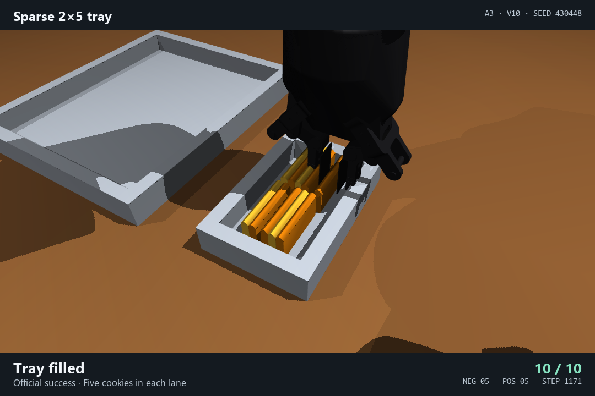
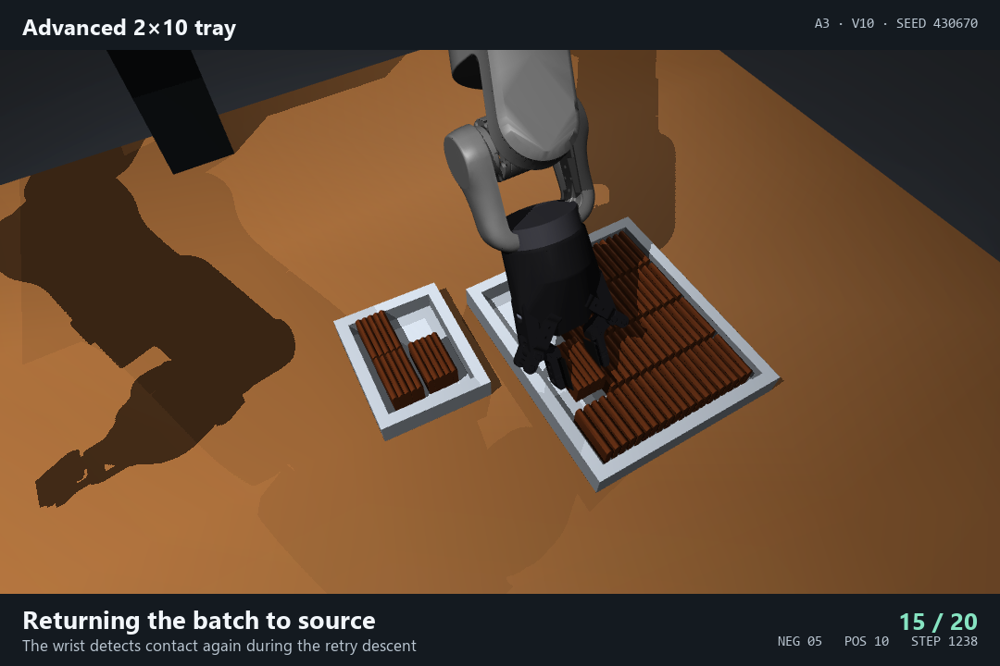
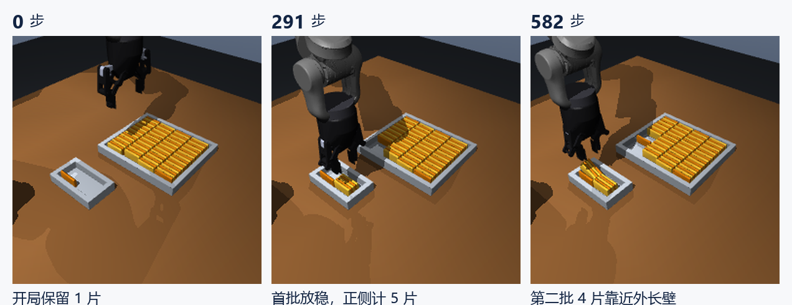

# AI305 A3 饼干搬运实验进展

V9 已通过稀疏短盒和可变预填两项正式评测。稀疏短盒成功 **4/5（80%）**，可变预填成功 **3/5（60%）**。V10 的六局指定开发复测有五局完整成功，包含三局稀疏短盒、一局低预填和一局高难长盒。

## 实验视频与关键帧

### 稀疏短盒 · `430448`

V10 分四批搬完十块，终局两列各五块。独立开发对照将最后一块沿盒长轴向空端移 3 毫米，得分从 6/10 提到 10/10。视频记录 V10 的同种子重放。 [MP4 视频](media/430448-sparse.mp4?raw=1)

### 高难长盒 · `430670`

第四批重新下降时发生碰撞。策略保持夹持，在第 1,148 至 1,327 步将饼干放回源盒，随后重新分配落点。V10 在第 1,799 步完整成功，目标盒两列各十块。视频约第 20 秒开始展示回源。 [MP4 视频](media/430670-long-return.mp4?raw=1) · [满盒终局](media/430670-long-finish.png)

### 低预填碰壁诊断 · `430708`

这三张正面相机帧来自 V7 的同场诊断回放。第二批四块都已夹起，第 512 至 513 步碰上负侧外长壁，第 522 步全部离开官方几何计分区域。到第 582 步，四块倾斜约 26°，均未计分。 [三帧来源](low-prefill-frames.json)

## 正式评测 `course-v1`

每个冻结版本用一组独立种子评测，计划 140 局，覆盖 18 项任务和 22 个任务档位。通过判定只认官方 `episode.success`。标准任务每项 30 局，至少成功 10 局才严格超过 30%。标准单档至少 4/10，其余任务至少 2/5。

<!-- official:begin -->

评测快照采集于北京时间 2026-11-27 09:43。表中「达标」表示该组已跑完并超过 30%，「锁定」表示已有足够的成功局，即使余下回合全部失败也会过线。

| 冻结版本 | 批次种子 | 有效回执 | 成功局 | 任务达标＋锁定 / 18 | 档位达标＋锁定 / 22 |
| --- | ---: | ---: | ---: | ---: | ---: |
| V1 | `440000` | 138/140 | 84 | 14＋2 / 18 | 16＋2 / 22 |
| V6 Registration | `450000` | 67/140 | 47 | 2＋2 / 18 | 6＋2 / 22 |
| V7 | `460000` | 41/140 | 29 | 1＋0 / 18 | 3＋1 / 22 |
| V9 | `470000` | 34/140 | 26 | 2＋1 / 18 | 4＋0 / 22 |

V9 的标准短盒已完成 24/30 局，成功 19 局，最终成功率至少 63%。基础档为 10/10，中档为 6/10。高档已回 4/10 局，成功 3 局。

V1 的两个倾斜任务各有一局在场景初始化时退出，使用同一开局补跑也复现了源列间距错误。V1 未过线的两个标准高档在 V6 中都取得了足够的成功局，其中长盒高档已成功 5 局。单一版本的 18 项达标与 22 档达标仍在验收。 [逐任务、逐档位及逐局记录](official-snapshot.json)

<!-- official:end -->

## V10 开发复测

V10 将已填列保护和稀疏短盒末片修正合到同一策略。已填列保护用抓取反馈和正面相机确认一列已满，避免再向该列投料。六局来自事先指定的开发种子。每局都复现对照的得分和成功判定。 [六局记录](development.json)

| 开局 | 场景 | 得分 | 步数 | 官方成功判定 |
| --- | --- | ---: | ---: | --- |
| `430448` | 稀疏短盒 | 10/10 | 1,171 | 成功 |
| `430422` | 稀疏短盒 | 10/10 | 1,161 | 成功 |
| `430435` | 稀疏短盒 | 10/10 | 1,160 | 成功 |
| `430708` | 低预填 | 5/9 | 1,450 | 到达开发时限 |
| `430643` | 低预填 | 9/9 | 537 | 成功 |
| `430670` | 高难长盒 | 20/20 | 1,799 | 成功 |

低预填的 6 毫米内移在 `430708` 将 5/9 提至 9/9，在 `430643` 将 9/9 降至 5/9。V10 采用已填列保护，该保护在 `430708` 保住原有饼干，在 `430643` 复现 537 步的完整成功。 [两组同场对照](development.json)

高难长盒 `430672` 的新回程连接成功把两批饼干送回源盒，终局仍为 10/20。第四批五块完整抵达目标上方，下降时先碰外长壁，复降又碰到对侧已放好的饼干。开爪前五块的倾角都已超过 15°，负侧最终计零。该开局的逐步诊断也收录在开发记录。 [长盒诊断](development.json)

## 记录与模拟环境

评测使用 `a3_dual_arm_sim` 修订 `2c36be484fe4f3eb5abc1c73c03597a887ef68fd`。策略使用公开 RGB、关节、末端位姿和力读数。媒体制作中的模拟状态与碰撞记录用于可视化和事后诊断。 [模拟器仓库](https://github.com/Eter0109/a3_dual_arm_sim)

正式评测快照列出 18 项、22 档以及有效回执的哈希。媒体记录列出录制对应的种子、回合结果和文件哈希。 [正式快照](official-snapshot.json) · [媒体来源](media-provenance.json)
